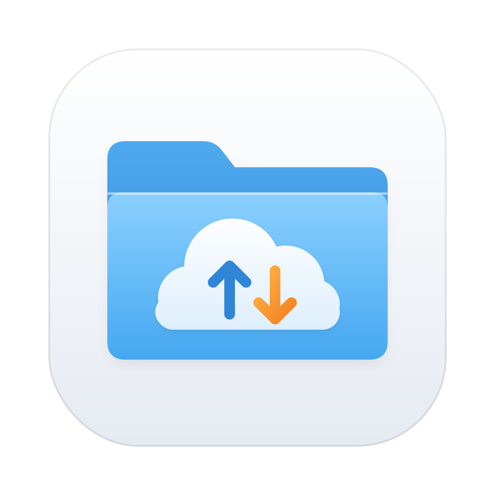
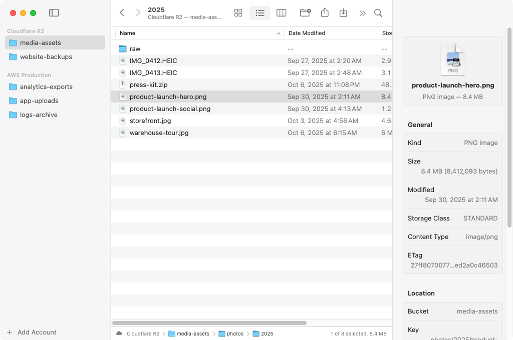
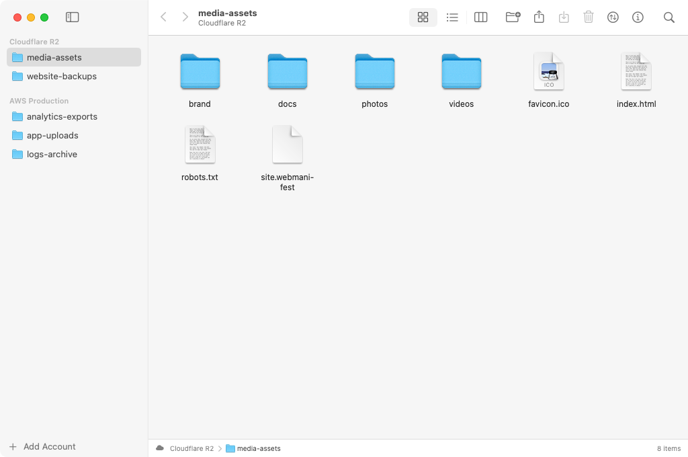
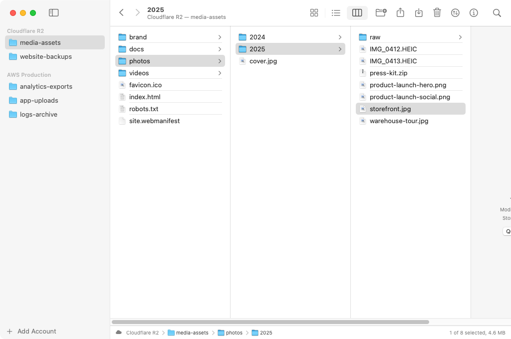

#  Bucket Browser

A native macOS app for browsing Amazon S3 and Cloudflare R2 buckets the way you browse files in Finder. Written in SwiftUI with a small, dependency-free S3 client.



| Icon view | Column view |
| --- | --- |
|  |  |

## Features

- **Sidebar of accounts and buckets.** Add as many AWS, R2 or other S3-compatible accounts as you like; each shows its buckets like Finder's Locations.
- **Icon, list and column views** (⌘1, ⌘2, ⌘3), with sortable columns, folders kept on top and search within the current folder.
- **Finder navigation:** back and forward (⌘[ and ⌘]), Enclosing Folder (⌘↑), Open (⌘↓ or double-click), and a clickable path bar with an item count.
- **Quick Look:** press Space or ⌘Y to preview any file. Previews are cached by ETag.
- **Drag and drop:** drop files or whole folders from Finder onto the window, a folder, a column or a path-bar segment to upload. Drag items out to Finder to download them.
- **File operations:** New Folder (⇧⌘N), Rename, Delete (⌘⌫), Upload (⇧⌘U) and Download (⌥⌘D), all from context menus too. Renaming and deleting work on folders recursively.
- **Get Info** (⌘I): size, dates, storage class, content type, ETag and user metadata.
- **Shareable links:** copy a presigned URL that expires in an hour, a day or seven days, or copy the `s3://` URI.
- **Transfers popover** with progress, cancel and Show in Finder. Large files upload in parallel multipart chunks.
- **Credentials live in the Keychain.** Account settings (names, regions, endpoints) go in user defaults; access keys never do.
- **iCloud sync.** In a build signed with a Developer ID, accounts and keys sync through iCloud Keychain, so they come back after a reinstall and show up on your other Macs.

## Requirements

- macOS 14 Sonoma or later
- Xcode 16 or later (Swift 5.10+) to build

## Build and run

```sh
# Run straight from the package
swift run BucketBrowser

# Or build a double-clickable app in build/Bucket Browser.app
scripts/build-app.sh            # release build for this Mac
UNIVERSAL=1 scripts/build-app.sh  # Apple silicon + Intel
open "build/Bucket Browser.app"
```

You can also open `Package.swift` in Xcode and run the `BucketBrowser` scheme.

Every CI run on GitHub builds a universal app and attaches it to the run as `BucketBrowser-app`. The app is ad-hoc signed, so the first time you open a downloaded copy, Control-click it and choose **Open**.

## iCloud sync

Apple only lets apps signed by a developer team use iCloud Keychain. Ad-hoc signed builds (the default, and `swift run`) keep accounts on this Mac only, and **Settings › Accounts** says so. To build a copy that syncs:

1. In [Certificates, Identifiers & Profiles](https://developer.apple.com/account/resources), register the App ID `com.bucketbrowser.app` under team `4TK5PNR392`. No extra capabilities are needed.
2. Create a **Developer ID Application** certificate if you don't have one, and install it in your login keychain.
3. Create a **Developer ID** provisioning profile for that App ID and download it.
4. Build:

   ```sh
   SIGN_IDENTITY="Developer ID Application: Your Name (4TK5PNR392)" \
   PROVISIONING_PROFILE=~/Downloads/BucketBrowser.provisionprofile \
   scripts/build-app.sh
   ```

If Xcode manages your Developer ID certificate in the cloud, its private key isn't in your keychain and `SIGN_IDENTITY` won't work. Sign through Xcode instead. Run `scripts/build-app.sh`, then:

```sh
DEV_PROFILE=path/to/development.provisionprofile scripts/export-developer-id.sh
```

`DEV_PROFILE` is a Mac development profile for your team that covers `com.bucketbrowser.app`, such as the "Mac Team Provisioning Profile: *" that Xcode keeps in `~/Library/Developer/Xcode/UserData/Provisioning Profiles`. The script wraps the app in an archive and has `xcodebuild -exportArchive` sign it with Developer ID through the account you're signed in to in Xcode. The signed app is written to `build/export/Bucket Browser.app`.

CI signs the app the same way when these repository secrets are set: `MACOS_CERTIFICATE_P12` (the certificate exported as .p12, base64 encoded), `MACOS_CERTIFICATE_PASSWORD`, and `MACOS_PROVISIONING_PROFILE` (base64 encoded). Add `NOTARY_APPLE_ID` and `NOTARY_PASSWORD` (an app-specific password) to have it notarized too.

The first time a signed build runs, it moves any accounts saved by an unsigned build into iCloud Keychain. Make sure iCloud Keychain is on in System Settings › Apple Account › iCloud › Passwords & Keychain.

## Adding an account

Choose **Add Account** at the bottom of the sidebar, or open **Settings › Accounts**.

| Service | What you need |
| --- | --- |
| Amazon S3 | An IAM access key and a default region. Each bucket's region is detected automatically. |
| Cloudflare R2 | Your Cloudflare account ID and an R2 API token's S3 access key ID and secret (R2 › Manage API Tokens). Pick the EU or FedRAMP jurisdiction if your buckets use one. |
| S3-compatible | The endpoint URL (for example `http://localhost:9000` for MinIO), the region and whether to use path-style URLs. |

If your key can read buckets but not list them (common with bucket-scoped R2 tokens), type the bucket names under **Buckets › Always Show** and they appear in the sidebar anyway. **Test Connection** checks the keys before you save.

## How it works

- `Sources/S3Kit` is a small async S3 client: AWS Signature Version 4 signing (headers and presigned URLs), ListBuckets, ListObjectsV2 with delimiters, HEAD, GET to file, PUT and multipart upload, CopyObject, and batched DeleteObjects. It uses only Foundation and CryptoKit.
- `Sources/BucketBrowser` is the SwiftUI app. Each window has its own `BrowserModel`; accounts and transfers are shared between windows.
- S3 has no real folders or renames. Folders are key prefixes ending in `/`, New Folder writes an empty `name/` marker object, and Rename copies each object to its new key and then deletes the original. Renaming a large folder therefore takes as long as copying it, and single objects over 5 GB can't be renamed.

## Demo mode and screenshots

Launch with `BUCKET_BROWSER_DEMO=1` to browse made-up R2 and AWS buckets without any credentials:

```sh
BUCKET_BROWSER_DEMO=1 swift run BucketBrowser
```

`scripts/take-screenshots.sh` uses demo mode to capture the images above. The **Screenshots** workflow runs it on a macOS runner and uploads the images as an artifact. Run the workflow by hand to also commit them to `docs/screenshots`.

## App icon

The icon's source is `Resources/AppIcon.svg`. To regenerate `Resources/AppIcon.png`, run `python3 scripts/render-icon.py` (it needs `cairosvg` and `Pillow`). `scripts/build-app.sh` turns the PNG into `AppIcon.icns`.

## Tests

```sh
swift test
```

The S3Kit tests check the signer against the AWS SigV4 test vectors and cover URL building for each provider, XML parsing and path helpers.
