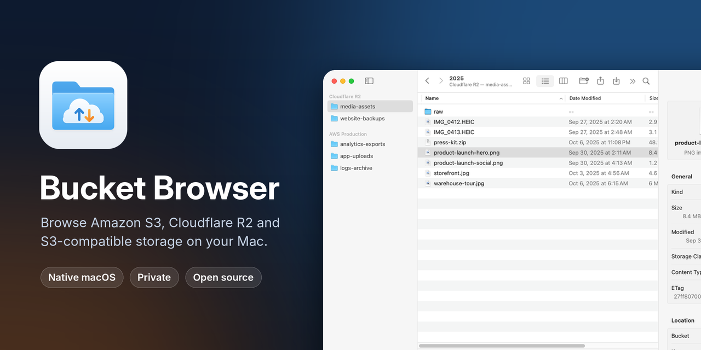
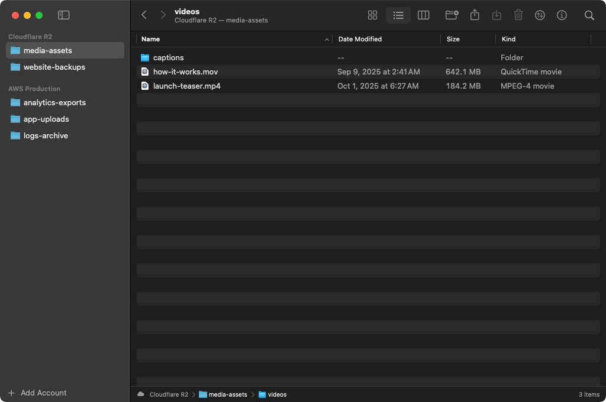
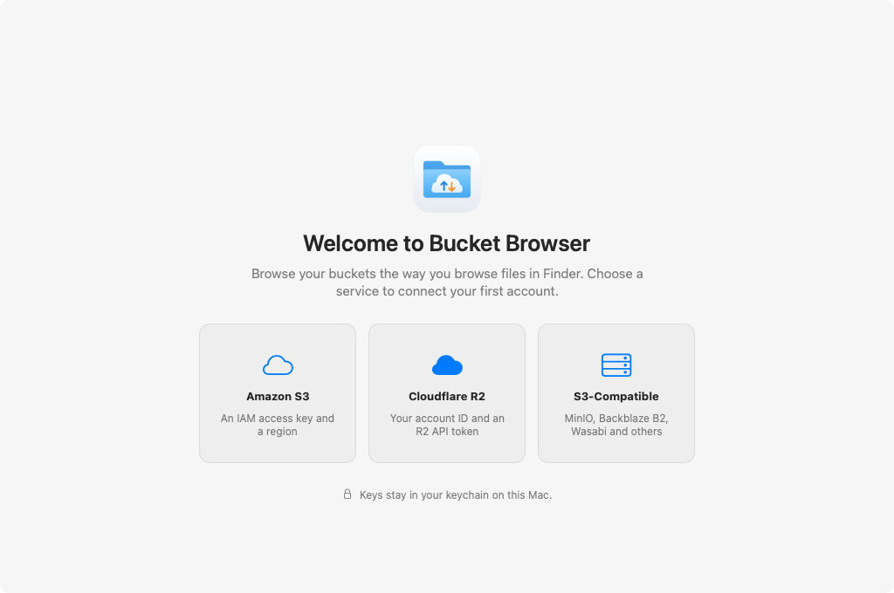

<p align="center">
  A fast, native Mac app for browsing Amazon S3, Cloudflare R2 and any S3-compatible storage.
</p>

<p align="center">
  <a href="https://github.com/chiranjeebhub/Bucket_Browser/releases/latest"></a>
  
  <a href="LICENSE"></a>
</p>

<p align="center">
  <a href="https://chiranjeebhub.github.io/bucket-browser-site/">Website</a> ·
  <a href="#install">Install</a> ·
  <a href="#features">Features</a> ·
  <a href="docs/privacy.md">Privacy</a>
</p>

Bucket Browser shows your buckets as folders and files. Add your keys once, then browse, preview, upload, download and share objects with the keyboard shortcuts and drag and drop you already use on your Mac. It's written in SwiftUI on top of a small, dependency-free S3 client, and it never talks to any server except the storage endpoints you add.

## Install

**Homebrew**

```sh
brew install --cask chiranjeebhub/tap/bucket-browser
```

**Disk image.** Download `BucketBrowser.dmg` from the [latest release](https://github.com/chiranjeebhub/Bucket_Browser/releases/latest), open it and drag Bucket Browser to Applications. The app is signed and notarized by Apple and updates itself.

**Mac App Store.** Coming soon.

Bucket Browser needs macOS 14 Sonoma or later and runs natively on Apple silicon and Intel Macs.

## Screenshots


| Icon view | Column view |
| --- | --- |
|  |  |

| Dark mode | Welcome screen |
| --- | --- |
|  |  |

## Features

- **All your storage in one sidebar.** Add as many Amazon S3, Cloudflare R2 or other S3-compatible accounts as you like such as MinIO, each with its buckets underneath.
- **Icon, list and column views** (⌘1, ⌘2, ⌘3), with sortable columns, folders kept on top and search within the current folder.
- **Keyboard navigation:** back and forward (⌘[ and ⌘]), Enclosing Folder (⌘↑), Open (⌘↓ or double-click), and a clickable path bar with an item count.
- **Quick Look:** press Space or ⌘Y to preview any file. Previews are cached by ETag.
- **Drag and drop:** drop files or whole folders onto the window, a folder, a column or a path-bar segment to upload them. Drag items out of the window to download them.
- **File operations:** New Folder (⇧⌘N), Rename, Delete (⌘⌫), Upload (⇧⌘U) and Download (⌥⌘D), all in context menus too. Renaming and deleting work on folders recursively.
- **Get Info** (⌘I): size, dates, storage class, content type, ETag and user metadata.
- **Shareable links:** copy a presigned URL that expires in an hour, a day or seven days, or copy the `s3://` URI.
- **Transfers** with progress and cancel. Large files upload in parallel multipart chunks.
- **Keys stay in the Keychain**, and sync to your other Macs through iCloud Keychain.
- **Private by design.** No analytics, no tracking and no servers of ours. See the [privacy policy](docs/privacy.md).

## Adding an account

Choose **Add Account** at the bottom of the sidebar, or open **Settings › Accounts**.

| Service | What you need |
| --- | --- |
| Amazon S3 | An IAM access key and a default region. Each bucket's region is detected automatically. |
| Cloudflare R2 | Your Cloudflare account ID and an R2 API token's S3 access key ID and secret (R2 › Manage API Tokens). Pick the EU or FedRAMP jurisdiction if your buckets use one. |
| S3-compatible | The endpoint URL (for example `http://localhost:9000` for MinIO), the region and whether to use path-style URLs. |

If your key can read buckets but not list them (common with bucket-scoped R2 tokens), type the bucket names under **Buckets › Always Show** and they appear in the sidebar anyway. **Test Connection** checks the keys before you save.
## Building from source

```sh
swift run BucketBrowser            # run straight from the package
scripts/build-app.sh               # or build build/Bucket Browser.app
```

Try it without any credentials in demo mode: `BUCKET_BROWSER_DEMO=1 swift run BucketBrowser`. Run the tests with `swift test`.

Signing, iCloud sync, Mac App Store packaging and the release process are covered in [docs/DEVELOPMENT.md](docs/DEVELOPMENT.md).

## Support

Found a bug or have an idea? [Open an issue](https://github.com/chiranjeebhub/Bucket_Browser/issues), or see the [support page](https://chiranjeebhub.github.io/bucket-browser-site/support/).

## License

Bucket Browser is released under the [MIT License](LICENSE). Copyright © 2026 Chiranjeeb Jena.
